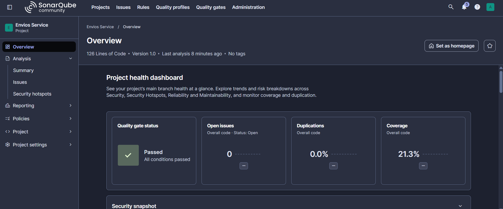
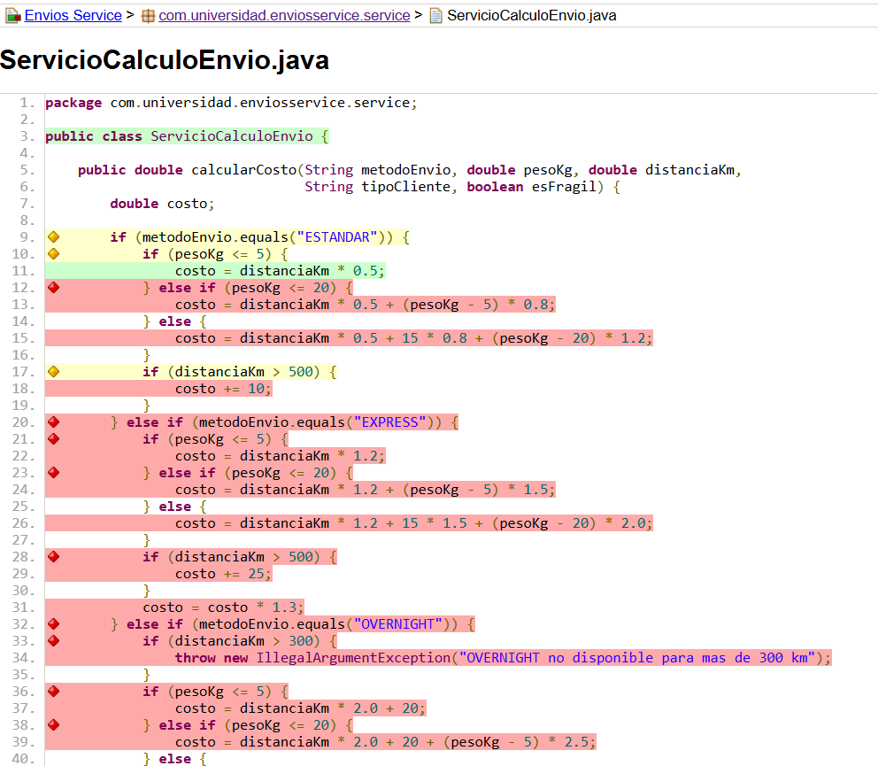
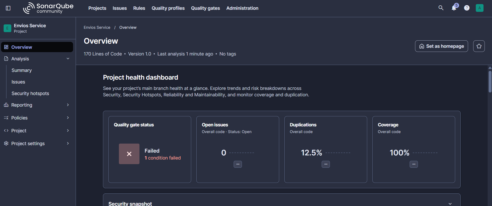
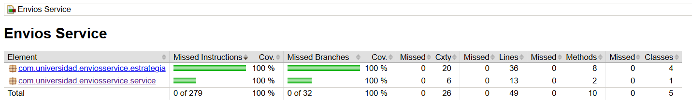

# Envios Service — Diagnóstico y Mejora Guiada por Métricas

## Decisiones de diseño

### 1. Entorno de análisis

SonarQube Community local con Docker. Se eligió por dos criterios de la tabla comparativa: no depende de conectividad ni de límites de un plan gratuito, y ofrece control total de la configuración (necesario para crear el Quality Profile y el Quality Gate personalizados). El costo asumido es que consume recursos de la máquina local y el contenedor debe mantenerse en ejecución. SonarCloud se descartó porque exige claves de proyecto únicas en toda la plataforma y configuración adicional de organización.

### 2. Exclusiones del análisis

No se excluyó ninguna clase. El proyecto no tiene clase de arranque ni código de infraestructura: todo `src/main/java` es lógica de negocio y cada clase aporta información real sobre la calidad del código.

### 3. Métrica usada como señal principal

Complejidad ciclomática. Cuenta los caminos independientes del método, que es el número mínimo de pruebas necesarias para recorrerlos, y explica el origen del problema: la cobertura baja es un síntoma de esa complejidad. La complejidad cognitiva mide dificultad de lectura y penaliza el anidamiento, pero aquí la pregunta era cuántos caminos había que separar y probar. La cobertura se usó como confirmación.

### 4. Patrón elegido: Strategy

Antes de refactorizar se analizó la naturaleza real de los condicionales de `calcularCosto()`:

- **State se descartó** porque el método no guarda ningún estado entre llamadas que condicione su comportamiento futuro; cada invocación es independiente.
- **Chain of Responsibility se descartó** porque no hay una secuencia de manejadores donde el orden de evaluación importe ni donde varios podrían aplicar antes de llegar al que resuelve: el valor de `metodoEnvio` identifica de forma exclusiva una sola rama.
- **Strategy aplica** porque cada rama calcula el mismo tipo de resultado (un costo) con una fórmula propia, elegida una sola vez por un valor de entrada, sin relación de orden ni de estado con las demás ramas.

Qué se movió y qué se quedó: a cada estrategia (`EnvioEstandarStrategy`, `EnvioExpressStrategy`, `EnvioOvernightStrategy`, `EnvioInternacionalStrategy`) se movieron la fórmula por tramos de peso y los recargos por distancia propios de su método, incluida la excepción de OVERNIGHT para más de 300 km. En el orquestador `ServicioCalculoEnvio` se quedaron deliberadamente el recargo por fragilidad y el descuento por tipo de cliente, porque son reglas transversales a todos los métodos de envío; mezclarlas en cada estrategia habría duplicado esa lógica cuatro veces. Por eso la complejidad no baja a 1: el orquestador conserva la validación de método no soportado, la fragilidad y los dos tramos de tipo de cliente.

### 5. Criterio de las pruebas agregadas

Cada prueba nueva se corresponde con una rama que el reporte JaCoCo de la Parte 1 mostraba sin cubrir:

| Rama sin cubrir (Parte 1) | Prueba que la cubre |
|---|---|
| Tramos de peso 5-20 kg y mayor a 20 kg de ESTANDAR | `EnvioEstandarStrategyTest.calculaCostoPorTramoDePeso` (incluye los límites 5 y 20) |
| Recargo por distancia mayor a 500 km | `aplicaRecargoSoloSobreLos500Km` (500 sin recargo, 501 con recargo) |
| Bloque completo de EXPRESS | `EnvioExpressStrategyTest` (tramos, recargo y multiplicador 1.3) |
| Bloque OVERNIGHT y su excepción | `EnvioOvernightStrategyTest` (tramos, límite de 300 km y rechazo de 301) |
| Bloque INTERNACIONAL y recargo mayor a 5000 km | `EnvioInternacionalStrategyTest` (tramos y límites 5000/5001) |
| Fragilidad en verdadero | `aplicaRecargoPorFragilidad` y `combinaFragilidadYDescuentoPremium` |
| Descuento CORPORATIVO | `aplicaDescuentoClienteCorporativo` |
| Método de envío no soportado | `rechazaMetodoDeEnvioNoSoportado` |
| Conexión orquestador-estrategias | `delegaEnLaEstrategiaDelMetodoSolicitado` |

Todas verifican un valor calculado distinto; ninguna repite un caso ya cubierto.

### 6. Realismo del Quality Gate

Se configuró la regla S1541 con umbral de complejidad **10** por método y un Quality Gate con cobertura mínima de **70%**, nuevos Code Smells en 0 y duplicación máxima de 5%. Se eligió 10 porque, según la Tabla 3.2 de la guía, es el techo del rango "Moderada" y el valor por defecto de la propia regla: es exigente sin forzar la reescritura de métodos que todavía son razonables de mantener. Un umbral de 5 obligaría a fragmentar métodos aceptables, y uno de 20 dejaría pasar justo el método que originó el problema (complejidad 20). Se eligió 70% y no 100% porque exigir cobertura total suele producir pruebas triviales solo para llenar el número (incentivos perversos, Sección 2.3 de la guía), mientras que 70% deja margen para código de infraestructura sin obligar a escribir pruebas vacías. SonarQube no permite limitar la complejidad por método directamente en el Quality Gate, por lo que ese límite se aplica en el Quality Profile y el gate lo hace cumplir mediante la condición de nuevos Code Smells.

## Comparación antes / después

| Métrica | Antes (Parte 1) | Después (Parte 2) |
|---------|------------------|--------------------|
| Complejidad ciclomática de calcularCosto() | ← COMPLETAR | ← COMPLETAR |
| Cobertura de ramas de la lógica de envío | ← COMPLETAR % | ← COMPLETAR % |
| Code Smells | ← COMPLETAR | ← COMPLETAR |
| Quality Gate | — | ← COMPLETAR (Passed / Failed y condición si falló) |

## Capturas

## Herramientas utilizadas

- Java 21, Apache Maven, JUnit 5
- SonarQube Community Edition (Docker), JaCoCo
- Git, GitHub, VS Code

## Conclusiones

Este laboratorio mostró que las métricas sirven como guía solo cuando se interpretan: la complejidad ciclomática de `calcularCosto()` explicó por qué la cobertura era baja, y el análisis de la naturaleza de los condicionales (sin estado, sin orden de evaluación, una fórmula por valor de entrada) fue lo que condujo a Strategy en lugar de State o Chain of Responsibility. La refactorización redujo la complejidad del método de forma medible, pero no a 1, porque las reglas transversales deben vivir en un único lugar. También quedó claro que subir la cobertura tiene valor solo si cada prueba nueva ejercita una rama distinta y verifica un resultado distinto, y que un umbral de Quality Gate debe ser exigente pero realista.